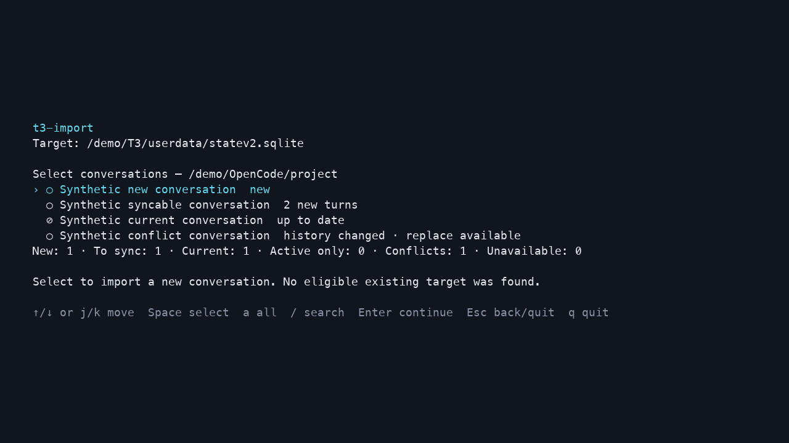
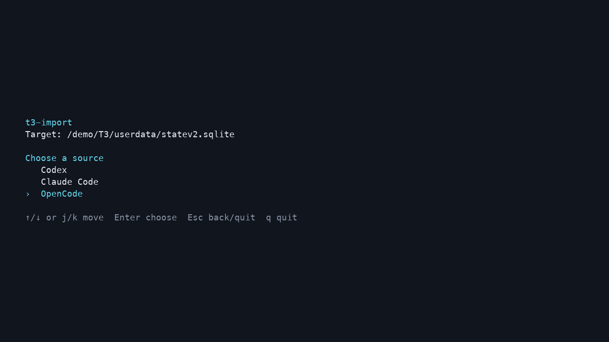

# t3-import

[](https://github.com/alsd4git/t3-import/actions/workflows/ci.yml)
[](https://github.com/alsd4git/t3-import/releases)
[](LICENSE)

Import and sync local **Codex, Claude Code, and OpenCode** conversations into
[T3 Code](https://github.com/pingdotgg/t3code), with native session bindings for
continuation, interactive previews, and verified backups.

Maintained fork by [alsd4git](https://github.com/alsd4git), based on
[CarlosGtrz/t3-import](https://github.com/CarlosGtrz/t3-import). This repository's
`main` is the development and release base. Existing upstream pull requests stay
open on their original branches. This is an independent tool, unaffiliated with
T3 Code or its providers.

## Compatibility

| T3 database | Supported migrations | Sources |
| --- | --- | --- |
| V1 | 40–54 | Codex, Claude Code |
| T3 0.1.0 / Orchestrator V2 | 62 | Codex, Claude Code, OpenCode |
| T3 0.1.1–0.1.2 / Orchestrator V2 | 67 | Codex, Claude Code, OpenCode |

Use **Node.js 22.21.1+ or 24+**. Unknown schemas, including intermediate V2
migrations, are refused. T3 owns database upgrades; the importer never migrates
your installation. OpenCode requires its 2.x SQLite session format.

Codex discovery and import read both `.jsonl` and Zstandard `.jsonl.zst`
rollouts directly. If both forms coexist, the plain rollout takes precedence.

History sync goes **from the provider into T3**. It is an explicit operation,
without a background watcher or reverse transcript writer. Continuing a bound
session from T3 uses the provider's native session. Titles remain separate from
transcript sync. See [compatibility and validation](docs/compatibility.md).

For a Linux T3 Connect server, `t3-import runtime status` reports persisted
activity and the owning service. The interactive importer offers to pause a
verified idle systemd service and restore it on exit. Scripts can opt in with
`--manage-runtime`. See [runtime maintenance](docs/runtime-maintenance.md).

## Install

The fork package is named `@alsdd/t3-import`; the command remains `t3-import`.
Install the scoped npm package, or use the pinned GitHub release tarball below.
The upstream `@carlosgtrz/t3-import` package does not contain this fork's features.

```sh
npm i -g @alsdd/t3-import --allow-scripts=better-sqlite3
t3-import --version
```

For a pinned GitHub release without the npm registry:

```sh
npm i -g --allow-scripts=better-sqlite3 https://github.com/alsd4git/t3-import/releases/download/v0.1.1-alsd.1/alsdd-t3-import-0.1.1-alsd.1.tgz
```

Versions follow `<T3 version>-alsd.<revision>`. `0.1.1-alsd.1` targets T3 0.1.1
and retains the earlier compatibility shown above. npm installs the default
`latest` channel; no `@next` suffix is required.

The script approval allows the native SQLite dependency to install with recent
npm versions. Older npm versions may report the option as unknown; their normal
install-script behavior still applies.

To build from source:

```sh
git clone https://github.com/alsd4git/t3-import.git
cd t3-import
npm ci
npm run build
node dist/cli.js
```

## Import and sync

Close T3 before importing, syncing, or replacing history. Every write creates a
verified database backup. Keep that backup and back up the external import ledger
separately when needed. See [storage and recovery](docs/usage.md#safety-and-storage).

Running `t3-import` opens the interactive flow. Choose a source and working folder,
review each conversation's status, select imports or safe updates, and confirm.
New imports offer compatible destination projects while preserving the source cwd.
Native "No project" is available only for eligible T3 scratch folders.



```sh
t3-import                               # interactive import and sync
t3-import import --source opencode      # start with OpenCode
t3-import sync --source codex            # focused interactive sync
t3-import sync --source codex --all --dry-run --yes --summary
t3-import sync --source codex --all --yes --summary
t3-import links --json                  # read-only identity report
```

`links` distinguishes current bindings, retained V1 identities and verified V2
context handoffs. It does not compare transcripts, rename threads, or establish
identity from similar titles. It can run while T3 is open, with provisional results.

The TUI explains pending additions, active turns, conflicts and unavailable
sources. Safe sync appends settled history only after verifying the existing
transcript prefix. Divergent or ambiguous histories need review. Exit code `7`
reports skipped reconciliation cases, even when other updates in the batch succeed.

### Demo



These captures use the actual TUI with synthetic conversations and an isolated
target. They stop at review before writing history.
[Reproduce the demo](docs/demo.md).

## Documentation

- [Commands, destinations, safety and storage](docs/usage.md)
- [Compatibility, pinned runtimes and vendoring](docs/compatibility.md)
- [OpenCode and T3 0.1.1 validation](docs/v011-opencode-validation.md)
- [Native continuation test and its limits](docs/continuation-validation-2026-10-22.md)
- [Packed install and CI checks](docs/package-validation.md)
- [Fork history and release process](docs/fork-maintenance.md)
- [Changelog](CHANGELOG.md)

Optional title normalization can consume `links` evidence. The personal
[`codex-thread-normalizer` skill](https://github.com/alsd4git/my-skills/tree/main/skills/codex-thread-normalizer)
is maintained separately and is not required to use the importer.

## Development

```sh
npm ci
npm run typecheck
npm test
npm run build
npm run package:check
```

CI checks Node 22/24 on Windows, macOS and Ubuntu. The package check installs a
tarball with independent dependencies, imports a synthetic conversation, appends
a turn, and verifies that repeated sync is a no-op. Additional pinned-runtime
checks and regeneration commands are described in the
[compatibility guide](docs/compatibility.md).

## Credits and license

Originally created by CarlosGtrz; fork maintenance and extensions by Alessandro
Digilio and contributors. Licensed under [MIT](LICENSE). Bundled T3 runtimes retain
their licenses, source references and third-party notices under `vendor/`.
